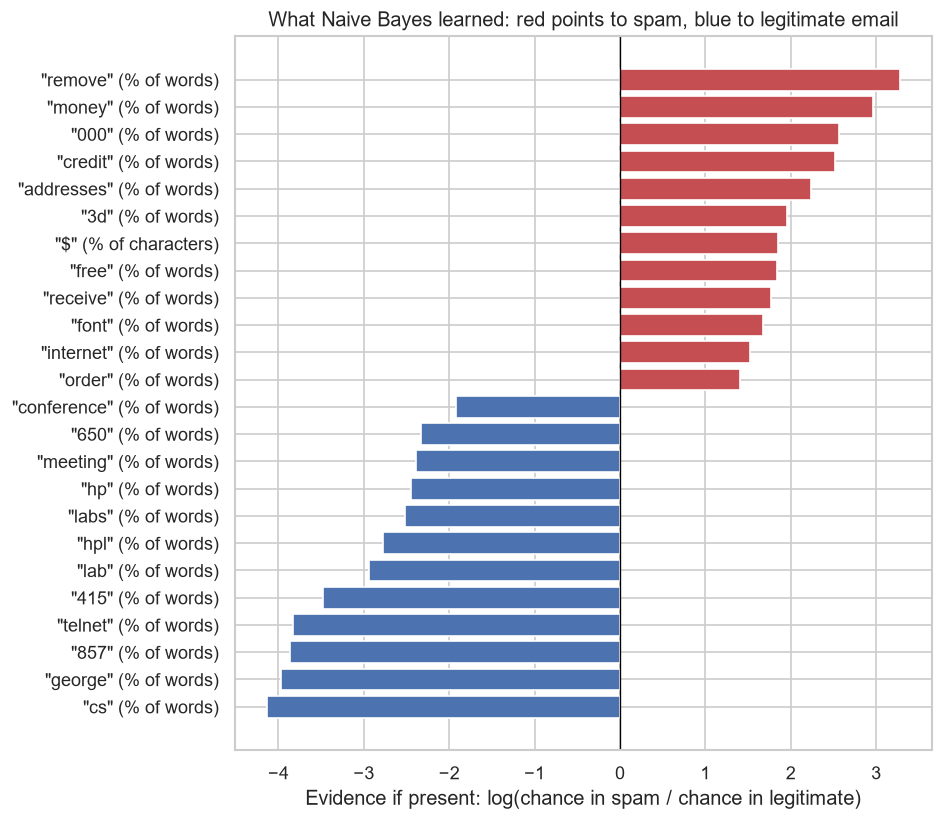

# Spam detector

Classifies email as spam or legitimate with Naive Bayes, from how often particular words and characters appear. Built on the UCI Spambase data, with an interactive demo that checks any email you paste in and shows which words pushed the verdict.



## Results

Test set: 1,151 of the 4,601 emails (stratified), never used for tuning or model choice. 39% of emails are spam.

| Model | Accuracy | Precision | Recall | F1 | ROC-AUC |
| --- | --- | --- | --- | --- | --- |
| **Bernoulli Naive Bayes** (word present or not) | 0.883 | 0.879 | 0.815 | 0.846 | 0.951 |
| Multinomial Naive Bayes (word counts) | 0.780 | 0.729 | 0.705 | 0.717 | 0.833 |
| Gaussian Naive Bayes (bell curve per input) | 0.831 | 0.713 | 0.954 | 0.816 | 0.947 |
| Random Forest (benchmark) | 0.953 | 0.963 | 0.916 | 0.939 | 0.986 |
| Always legitimate (baseline) | 0.606 | 0 | 0 | 0 | 0.500 |

Precision, recall and F1 are for the spam class.

- **Presence beats counts here.** Bernoulli Naive Bayes, which only asks whether each word appears, is the best Naive Bayes. Multinomial does worst because the capital-letter totals run into the thousands and drown out the word frequencies.
- **Spam words:** *remove*, *money*, *000*, *credit*, *addresses* and `$`. **Legitimate words:** *george*, *cs*, *857*, *telnet*, *hp* and *lab*.
- **The legitimate words are the dataset's quirk.** The real emails came from one person's inbox at Hewlett-Packard Labs, so their first name, employer and phone area codes became signs of a real email. The filter fits that inbox, not yours.
- **The forest is stronger** (F1 0.94) but can't be read word by word; Naive Bayes can.

Full tables and figures: [docs/results.md](docs/results.md). How it was done: [docs/methodology.md](docs/methodology.md).

## Run it

Needs Python 3.14+ and [uv](https://docs.astral.sh/uv/).

```bash
uv sync
uv run python main.py
uv run streamlit run app.py
```

`main.py` downloads the data once into `data/`, then writes figures and tables to `outputs/`, models to `models/` and the tables to `docs/results.md`. Outputs and models are committed, so the demo works without running it.

## The demo

- **Overview**: what the project is, how Naive Bayes decides and what was found.
- **Check an email**: paste an email or start from an example, pick a model, and see the chance of spam and the inputs that pushed it.
- **Spam words**: what Naive Bayes learned about every word and character.
- **Results**: model comparison, ROC curves, mistakes, permutation importance and data checks.

## Layout

```
spam_detector/   spec.py (inputs and models), data.py (download), features.py (text to the 57 inputs),
                 explain.py (word evidence), report.py
pxlab/           shared engine (vendored): data checks, pipelines, tuning, evaluation, app helpers
main.py          the full study
app.py           the Streamlit demo
docs/            methodology, results, deploy
```

## Data

Hopkins, Reeber, Forman and Suermondt (1999), [Spambase](https://archive.ics.uci.edu/dataset/94/spambase), UCI Machine Learning Repository, CC BY 4.0. The emails themselves aren't published, only the 57 measurements per email.

## License

MIT
