# Results

Produced by `python main.py`. The test set is 25% of the 4,601 emails (stratified) and was not used for tuning or model choice. Spam is the positive class: precision is the share of emails flagged as spam that really were spam, recall the share of spam that was caught.

## Models

### Test-set scores (spam is the positive class)

| Model | Role | CV f1 | Accuracy | Balanced accuracy | Precision | Recall | F1 | ROC-AUC |
| --- | --- | --- | --- | --- | --- | --- | --- | --- |
| Bernoulli Naive Bayes | Naive Bayes: word present or not | 0.848 | 0.883 | 0.871 | 0.879 | 0.815 | 0.846 | 0.951 |
| Multinomial Naive Bayes | Naive Bayes: how often each word appears | 0.725 | 0.78 | 0.767 | 0.729 | 0.705 | 0.717 | 0.833 |
| Gaussian Naive Bayes | Naive Bayes: bell curve per input | 0.806 | 0.831 | 0.852 | 0.713 | 0.954 | 0.816 | 0.947 |
| Random Forest | Benchmark beyond the course | 0.936 | 0.953 | 0.947 | 0.963 | 0.916 | 0.939 | 0.986 |
| Always legitimate | Baseline | 0.0 | 0.606 | 0.5 | 0.0 | 0.0 | 0.0 | 0.5 |

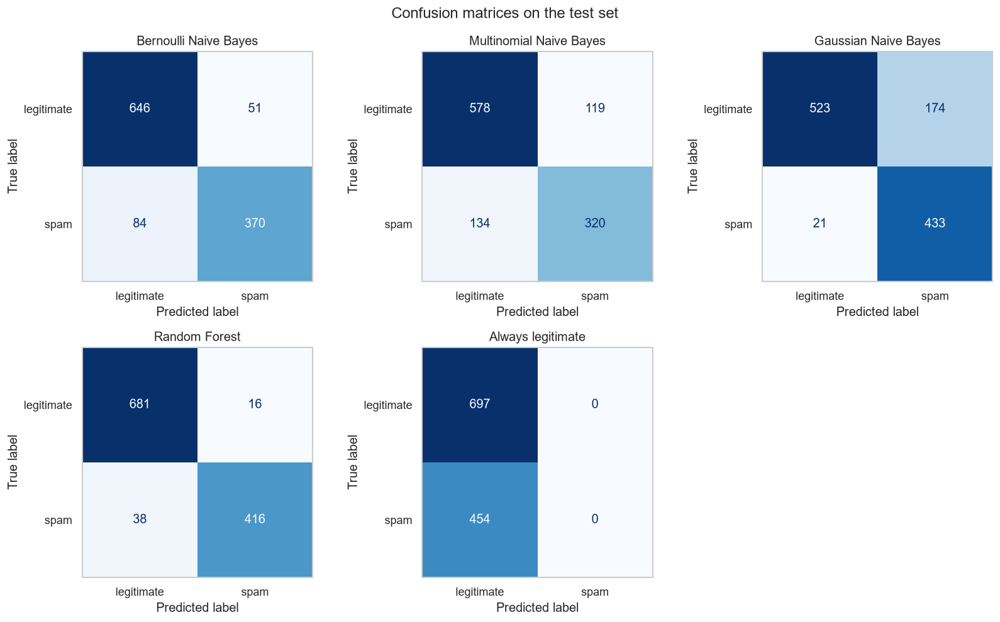

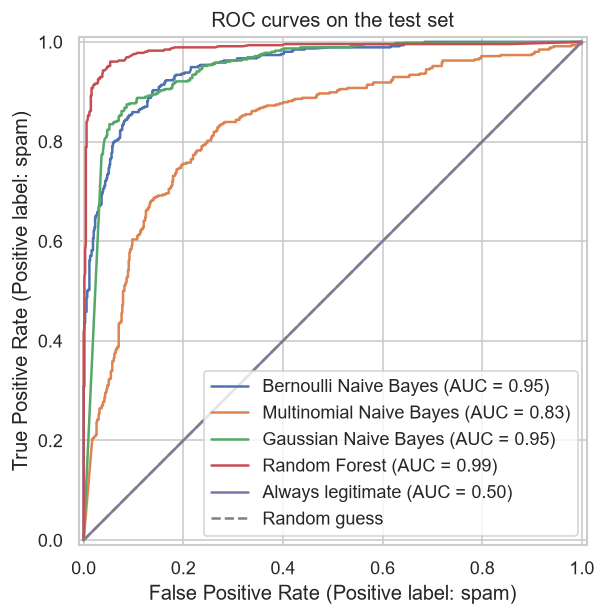

## Key findings

### What the in-depth analysis found

| Finding |
| --- |
| Random Forest scores F1 0.939 on the test set (95% interval 0.923 to 0.955); the baseline that ignores the inputs (Always legitimate) scores 0.000. |
| Random Forest against Bernoulli Naive Bayes on right or wrong answers (McNemar): real difference (p = 0.000). |
| Random Forest against Multinomial Naive Bayes on right or wrong answers (McNemar): real difference (p = 0.000). |
| Random Forest against Gaussian Naive Bayes on right or wrong answers (McNemar): real difference (p = 0.000). |
| Random Forest against Always legitimate on right or wrong answers (McNemar): real difference (p = 0.000). |
| Bernoulli Naive Bayes generalises well: training and validation f1 are close (+0.003); validation has levelled off, so more data alone would help little. |
| Multinomial Naive Bayes generalises well: training and validation f1 are close (-0.001); validation has levelled off, so more data alone would help little. |
| Gaussian Naive Bayes generalises well: training and validation f1 are close (+0.002); validation has levelled off, so more data alone would help little. |
| Random Forest generalises well: training and validation f1 are close (+0.062); validation has levelled off, so more data alone would help little. |
| Cut-off for Random Forest: 0.65 instead of 0.5, chosen for the lowest cost. On the test set: recall 0.92 to 0.87, precision 0.96 to 0.97, cost per 100 cases 10.3 to 9.6. |
| Most honest probabilities: Random Forest recalibrated (isotonic) (Brier 0.036); Random Forest has Brier 0.042 and calibration error 0.052. |
| The input that most separates caught from missed spam is "$" (% of characters): average 0.19 when caught, 0.008 when missed. |
| When Random Forest is at least 90% sure it is right 99% of the time (68% of test cases). |

## Reliability

Bootstrap 95% intervals: how much each test score could move with a different test sample.

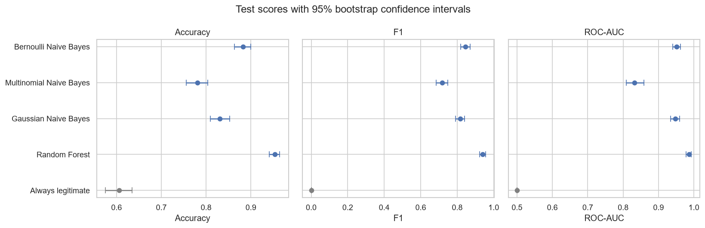

### Confidence intervals

| Model | Score | Test value | Low | High |
| --- | --- | --- | --- | --- |
| Bernoulli Naive Bayes | Accuracy | 0.8827 | 0.8636 | 0.9001 |
| Bernoulli Naive Bayes | F1 | 0.8457 | 0.8191 | 0.8706 |
| Bernoulli Naive Bayes | ROC-AUC | 0.951 | 0.9397 | 0.962 |
| Multinomial Naive Bayes | Accuracy | 0.7802 | 0.7559 | 0.8036 |
| Multinomial Naive Bayes | F1 | 0.7167 | 0.6838 | 0.748 |
| Multinomial Naive Bayes | ROC-AUC | 0.8326 | 0.8083 | 0.8581 |
| Gaussian Naive Bayes | Accuracy | 0.8306 | 0.8097 | 0.8523 |
| Gaussian Naive Bayes | F1 | 0.8162 | 0.7909 | 0.8408 |
| Gaussian Naive Bayes | ROC-AUC | 0.9474 | 0.9345 | 0.9596 |
| Random Forest | Accuracy | 0.9531 | 0.9409 | 0.9644 |
| Random Forest | F1 | 0.9391 | 0.9227 | 0.9549 |
| Random Forest | ROC-AUC | 0.9862 | 0.9783 | 0.9926 |
| Always legitimate | Accuracy | 0.6056 | 0.5752 | 0.6342 |
| Always legitimate | F1 | 0.0 | 0.0 | 0.0 |
| Always legitimate | ROC-AUC | 0.5 | 0.5 | 0.5 |

### Is the best model really better? (paired tests)

| Best model | Compared with | Best is better on | Other is better on | Test | p-value | Verdict |
| --- | --- | --- | --- | --- | --- | --- |
| Random Forest | Bernoulli Naive Bayes | 90 | 9 | McNemar | 0.0 | Real difference |
| Random Forest | Multinomial Naive Bayes | 223 | 24 | McNemar | 0.0 | Real difference |
| Random Forest | Gaussian Naive Bayes | 174 | 33 | McNemar | 0.0 | Real difference |
| Random Forest | Always legitimate | 416 | 16 | McNemar | 0.0 | Real difference |

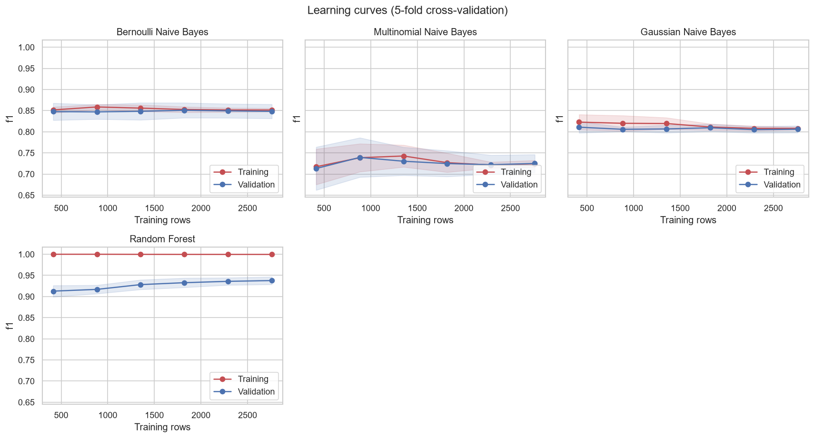

### Learning curves

| Model | Training rows | Training score | Validation score |
| --- | --- | --- | --- |
| Bernoulli Naive Bayes | 414 | 0.8517 | 0.8476 |
| Bernoulli Naive Bayes | 883 | 0.8586 | 0.847 |
| Bernoulli Naive Bayes | 1352 | 0.8559 | 0.8484 |
| Bernoulli Naive Bayes | 1821 | 0.8526 | 0.8509 |
| Bernoulli Naive Bayes | 2290 | 0.8515 | 0.8495 |
| Bernoulli Naive Bayes | 2760 | 0.8515 | 0.8483 |
| Multinomial Naive Bayes | 414 | 0.7172 | 0.713 |
| Multinomial Naive Bayes | 883 | 0.7386 | 0.7393 |
| Multinomial Naive Bayes | 1352 | 0.7427 | 0.7303 |
| Multinomial Naive Bayes | 1821 | 0.7269 | 0.7247 |
| Multinomial Naive Bayes | 2290 | 0.7213 | 0.7221 |
| Multinomial Naive Bayes | 2760 | 0.7242 | 0.7249 |
| Gaussian Naive Bayes | 414 | 0.8228 | 0.8108 |
| Gaussian Naive Bayes | 883 | 0.82 | 0.8058 |
| Gaussian Naive Bayes | 1352 | 0.8195 | 0.8067 |
| Gaussian Naive Bayes | 1821 | 0.8112 | 0.8094 |
| Gaussian Naive Bayes | 2290 | 0.808 | 0.805 |
| Gaussian Naive Bayes | 2760 | 0.8078 | 0.806 |
| Random Forest | 414 | 1.0 | 0.9127 |
| Random Forest | 883 | 1.0 | 0.9169 |
| Random Forest | 1352 | 0.9998 | 0.9282 |
| Random Forest | 1821 | 0.9997 | 0.9327 |
| Random Forest | 2290 | 0.9997 | 0.9359 |
| Random Forest | 2760 | 0.9996 | 0.9377 |

## Cut-off and calibration

The cut-off is chosen on cross-validated training predictions, then checked on the test set. Costs: a false alarm costs 5, a miss costs 1. A real email lost in the spam folder can be missed for good; a spam that gets through is deleted in a second.

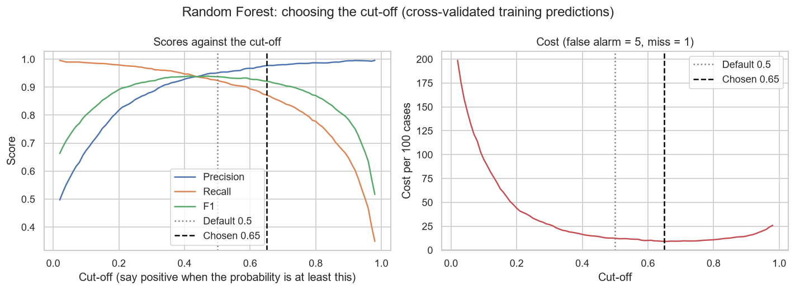

### Default against tuned cut-off on the test set

| Model | Cut-off | Threshold | Precision | Recall | F1 | Accuracy | Cost per 100 cases | TP | FP | FN | TN |
| --- | --- | --- | --- | --- | --- | --- | --- | --- | --- | --- | --- |
| Bernoulli Naive Bayes | Default | 0.5 | 0.879 | 0.815 | 0.846 | 0.883 | 29.453 | 370 | 51 | 84 | 646 |
| Bernoulli Naive Bayes | Tuned | 0.96 | 0.915 | 0.714 | 0.802 | 0.861 | 24.327 | 324 | 30 | 130 | 667 |
| Multinomial Naive Bayes | Default | 0.5 | 0.729 | 0.705 | 0.717 | 0.78 | 63.336 | 320 | 119 | 134 | 578 |
| Multinomial Naive Bayes | Tuned | 0.98 | 0.804 | 0.577 | 0.672 | 0.778 | 44.483 | 262 | 64 | 192 | 633 |
| Gaussian Naive Bayes | Default | 0.5 | 0.713 | 0.954 | 0.816 | 0.831 | 77.411 | 433 | 174 | 21 | 523 |
| Gaussian Naive Bayes | Tuned | 0.98 | 0.719 | 0.952 | 0.819 | 0.834 | 75.326 | 432 | 169 | 22 | 528 |
| Random Forest | Default | 0.5 | 0.963 | 0.916 | 0.939 | 0.953 | 10.252 | 416 | 16 | 38 | 681 |
| Random Forest | Tuned | 0.65 | 0.975 | 0.866 | 0.917 | 0.938 | 9.644 | 393 | 10 | 61 | 687 |
| Always legitimate | Default | 0.5 | 0.0 | 0.0 | 0.0 | 0.606 | 39.444 | 0 | 0 | 454 | 697 |
| Always legitimate | Tuned | 0.02 | 0.0 | 0.0 | 0.0 | 0.606 | 39.444 | 0 | 0 | 454 | 697 |

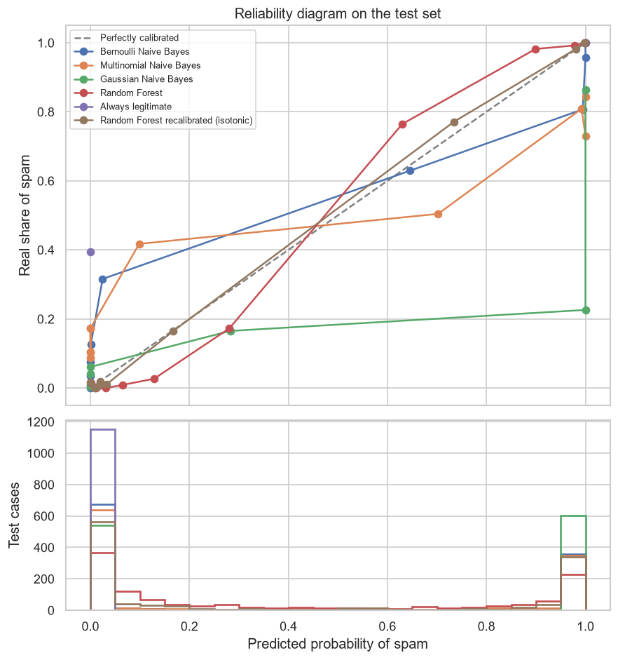

### How honest the probabilities are

| Model | Brier score | Calibration error | Mean predicted | Real positive share |
| --- | --- | --- | --- | --- |
| Bernoulli Naive Bayes | 0.1024 | 0.0938 | 0.3659 | 0.3944 |
| Multinomial Naive Bayes | 0.1918 | 0.1816 | 0.3791 | 0.3944 |
| Gaussian Naive Bayes | 0.1688 | 0.1697 | 0.5278 | 0.3944 |
| Random Forest | 0.0415 | 0.0519 | 0.3994 | 0.3944 |
| Always legitimate | 0.3944 | 0.3944 | 0.0 | 0.3944 |
| Random Forest recalibrated (isotonic) | 0.0363 | 0.0098 | 0.3932 | 0.3944 |

## Error analysis

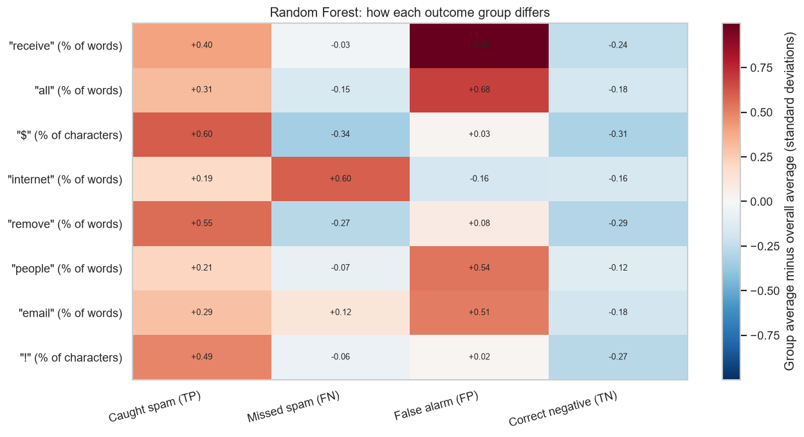

### Average inputs per outcome group

| Input | Caught spam (TP) | Missed spam (FN) | False alarm (FP) | Correct negative (TN) |
| --- | --- | --- | --- | --- |
| Cases | 393.0 | 61.0 | 10.0 | 687.0 |
| "receive" (% of words) | 0.109 | 0.044 | 0.198 | 0.012 |
| "all" (% of words) | 0.459 | 0.219 | 0.647 | 0.207 |
| "$" (% of characters) | 0.19 | 0.008 | 0.079 | 0.012 |
| "internet" (% of words) | 0.226 | 0.445 | 0.034 | 0.037 |
| "remove" (% of words) | 0.292 | 0.012 | 0.131 | 0.005 |
| "people" (% of words) | 0.153 | 0.075 | 0.241 | 0.061 |
| "email" (% of words) | 0.305 | 0.224 | 0.411 | 0.079 |
| "!" (% of characters) | 0.58 | 0.223 | 0.277 | 0.085 |

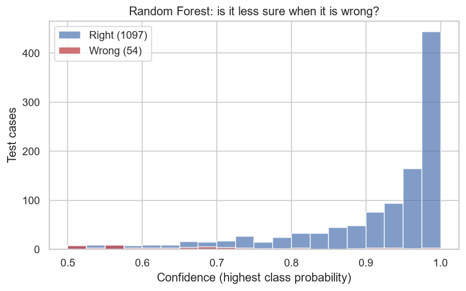

### Accuracy by confidence

| Confidence | Cases | Share of the test set | Accuracy |
| --- | --- | --- | --- |
| 0% to 60% | 53 | 0.046 | 0.604 |
| 60% to 70% | 62 | 0.054 | 0.774 |
| 70% to 80% | 90 | 0.078 | 0.911 |
| 80% to 90% | 162 | 0.141 | 0.975 |
| 90% to 100% | 784 | 0.681 | 0.991 |

## Spam words

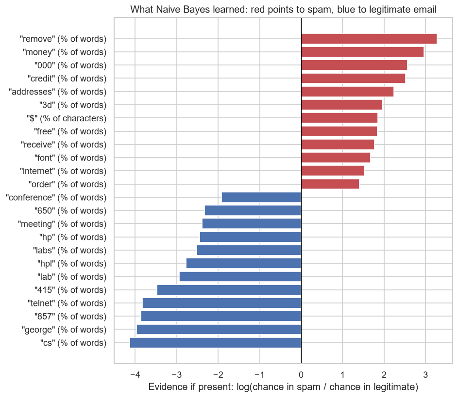

### What Bernoulli Naive Bayes learned per input

| Input | Present in spam | Present in legitimate | Evidence if present |
| --- | --- | --- | --- |
| "remove" (% of words) | 0.42 | 0.016 | 3.28 |
| "money" (% of words) | 0.377 | 0.02 | 2.96 |
| "000" (% of words) | 0.338 | 0.026 | 2.57 |
| "credit" (% of words) | 0.202 | 0.016 | 2.52 |
| "addresses" (% of words) | 0.152 | 0.016 | 2.24 |
| "3d" (% of words) | 0.024 | 0.003 | 1.95 |
| "$" (% of characters) | 0.62 | 0.097 | 1.85 |
| "free" (% of words) | 0.539 | 0.085 | 1.84 |
| "receive" (% of words) | 0.31 | 0.053 | 1.77 |
| "font" (% of words) | 0.049 | 0.009 | 1.68 |
| "internet" (% of words) | 0.338 | 0.074 | 1.52 |
| "order" (% of words) | 0.309 | 0.076 | 1.41 |
| "business" (% of words) | 0.388 | 0.096 | 1.4 |
| "address" (% of words) | 0.344 | 0.096 | 1.28 |
| "over" (% of words) | 0.376 | 0.11 | 1.23 |
| "#" (% of characters) | 0.282 | 0.084 | 1.21 |
| "email" (% of words) | 0.383 | 0.124 | 1.12 |
| "!" (% of characters) | 0.831 | 0.274 | 1.11 |
| "our" (% of words) | 0.63 | 0.22 | 1.05 |
| "mail" (% of words) | 0.46 | 0.165 | 1.03 |
| "report" (% of words) | 0.126 | 0.048 | 0.96 |
| "your" (% of words) | 0.81 | 0.34 | 0.87 |
| "make" (% of words) | 0.352 | 0.147 | 0.87 |
| "people" (% of words) | 0.28 | 0.119 | 0.86 |
| "all" (% of words) | 0.613 | 0.271 | 0.82 |
| "you" (% of words) | 0.884 | 0.574 | 0.43 |
| "will" (% of words) | 0.634 | 0.421 | 0.41 |
| "direct" (% of words) | 0.11 | 0.086 | 0.24 |
| "(" (% of characters) | 0.656 | 0.54 | 0.19 |
| Total capital letters | 1.0 | 1.0 | -0.0 |
| Longest run of capitals | 1.0 | 1.0 | -0.0 |
| Average run of capitals | 1.0 | 1.0 | -0.0 |
| "parts" (% of words) | 0.018 | 0.019 | -0.01 |
| "re" (% of words) | 0.268 | 0.3 | -0.11 |
| ";" (% of characters) | 0.15 | 0.179 | -0.18 |
| "table" (% of words) | 0.01 | 0.013 | -0.34 |
| "[" (% of characters) | 0.073 | 0.132 | -0.59 |
| "original" (% of words) | 0.05 | 0.1 | -0.7 |
| "technology" (% of words) | 0.056 | 0.17 | -1.11 |
| "data" (% of words) | 0.036 | 0.119 | -1.19 |
| "project" (% of words) | 0.027 | 0.099 | -1.29 |
| "pm" (% of words) | 0.028 | 0.11 | -1.37 |
| "edu" (% of words) | 0.037 | 0.154 | -1.43 |
| "1999" (% of words) | 0.059 | 0.258 | -1.48 |
| "85" (% of words) | 0.024 | 0.161 | -1.89 |
| "conference" (% of words) | 0.01 | 0.065 | -1.92 |
| "650" (% of words) | 0.015 | 0.159 | -2.33 |
| "meeting" (% of words) | 0.011 | 0.121 | -2.39 |
| "hp" (% of words) | 0.032 | 0.367 | -2.45 |
| "labs" (% of words) | 0.013 | 0.155 | -2.52 |
| "hpl" (% of words) | 0.017 | 0.274 | -2.78 |
| "lab" (% of words) | 0.007 | 0.125 | -2.94 |
| "415" (% of words) | 0.002 | 0.072 | -3.48 |
| "telnet" (% of words) | 0.002 | 0.102 | -3.83 |
| "857" (% of words) | 0.001 | 0.071 | -3.87 |
| "george" (% of words) | 0.005 | 0.272 | -3.97 |
| "cs" (% of words) | 0.001 | 0.047 | -4.14 |

## Which inputs matter

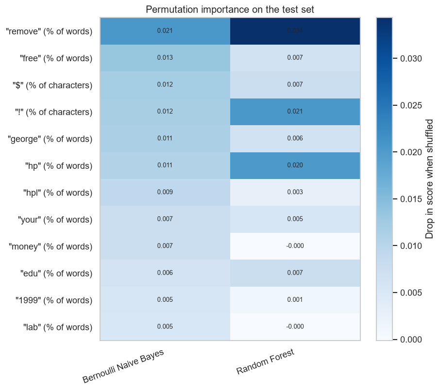

### Permutation importance (drop in F1 when the input is shuffled)

|  | Bernoulli Naive Bayes | Random Forest |
| --- | --- | --- |
| "remove" (% of words) | 0.0205 | 0.0343 |
| "free" (% of words) | 0.0134 | 0.0065 |
| "$" (% of characters) | 0.0121 | 0.0075 |
| "!" (% of characters) | 0.0116 | 0.0206 |
| "george" (% of words) | 0.0115 | 0.0064 |
| "hp" (% of words) | 0.0106 | 0.0203 |
| "hpl" (% of words) | 0.0092 | 0.0026 |
| "your" (% of words) | 0.0075 | 0.0055 |
| "money" (% of words) | 0.0074 | -0.0001 |
| "edu" (% of words) | 0.0061 | 0.0074 |
| "1999" (% of words) | 0.0053 | 0.0012 |
| "lab" (% of words) | 0.0051 | -0.0001 |
| "labs" (% of words) | 0.0048 | 0.0009 |
| "cs" (% of words) | 0.0046 | -0.0002 |
| "meeting" (% of words) | 0.0042 | -0.0002 |
| "conference" (% of words) | 0.0041 | 0.0 |
| "650" (% of words) | 0.004 | 0.0023 |
| "85" (% of words) | 0.0037 | -0.0005 |
| "telnet" (% of words) | 0.0036 | 0.0 |
| "pm" (% of words) | 0.0034 | 0.0 |
| "internet" (% of words) | 0.0031 | 0.0013 |
| "you" (% of words) | 0.003 | 0.0052 |
| "3d" (% of words) | 0.0025 | 0.0 |
| "technology" (% of words) | 0.0025 | 0.0016 |
| "857" (% of words) | 0.002 | -0.0001 |
| "font" (% of words) | 0.0019 | 0.0013 |
| "project" (% of words) | 0.0016 | 0.0 |
| "000" (% of words) | 0.0013 | 0.0009 |
| "data" (% of words) | 0.0012 | 0.0013 |
| "report" (% of words) | 0.0011 | 0.0 |
| "415" (% of words) | 0.001 | -0.0001 |
| ";" (% of characters) | 0.0009 | 0.0004 |
| "#" (% of characters) | 0.0007 | 0.0011 |
| "receive" (% of words) | 0.0006 | -0.0019 |
| "business" (% of words) | 0.0005 | 0.0019 |
| "table" (% of words) | 0.0004 | 0.0 |
| "credit" (% of words) | 0.0001 | -0.0001 |
| "our" (% of words) | 0.0 | 0.0105 |
| Total capital letters | 0.0 | 0.0011 |
| Longest run of capitals | 0.0 | 0.0066 |
| "parts" (% of words) | 0.0 | 0.0 |
| Average run of capitals | 0.0 | 0.012 |
| "direct" (% of words) | -0.0001 | 0.0 |
| "addresses" (% of words) | -0.0002 | -0.0001 |
| "original" (% of words) | -0.0003 | 0.0 |
| "order" (% of words) | -0.0007 | -0.0003 |
| "[" (% of characters) | -0.0009 | 0.0004 |
| "(" (% of characters) | -0.0014 | 0.0062 |
| "re" (% of words) | -0.0014 | 0.0041 |
| "address" (% of words) | -0.0017 | -0.0005 |
| "email" (% of words) | -0.0024 | 0.0018 |
| "make" (% of words) | -0.0028 | 0.0004 |
| "will" (% of words) | -0.0044 | 0.0026 |
| "mail" (% of words) | -0.0047 | 0.0008 |
| "people" (% of words) | -0.0049 | 0.0 |
| "over" (% of words) | -0.0058 | 0.0014 |
| "all" (% of words) | -0.0092 | -0.0003 |

## Mistakes

### Test emails Bernoulli Naive Bayes got wrong

| word_freq_make | word_freq_address | word_freq_all | word_freq_3d | word_freq_our | word_freq_over | word_freq_remove | word_freq_internet | word_freq_order | word_freq_mail | word_freq_receive | word_freq_will | word_freq_people | word_freq_report | word_freq_addresses | word_freq_free | word_freq_business | word_freq_email | word_freq_you | word_freq_credit | word_freq_your | word_freq_font | word_freq_000 | word_freq_money | word_freq_hp | word_freq_hpl | word_freq_george | word_freq_650 | word_freq_lab | word_freq_labs | word_freq_telnet | word_freq_857 | word_freq_data | word_freq_415 | word_freq_85 | word_freq_technology | word_freq_1999 | word_freq_parts | word_freq_pm | word_freq_direct | word_freq_cs | word_freq_meeting | word_freq_original | word_freq_project | word_freq_re | word_freq_edu | word_freq_table | word_freq_conference | char_freq_; | char_freq_( | char_freq_[ | char_freq_! | char_freq_$ | char_freq_# | capital_run_length_average | capital_run_length_longest | capital_run_length_total | Real | Predicted |
| --- | --- | --- | --- | --- | --- | --- | --- | --- | --- | --- | --- | --- | --- | --- | --- | --- | --- | --- | --- | --- | --- | --- | --- | --- | --- | --- | --- | --- | --- | --- | --- | --- | --- | --- | --- | --- | --- | --- | --- | --- | --- | --- | --- | --- | --- | --- | --- | --- | --- | --- | --- | --- | --- | --- | --- | --- | --- | --- |
| 0.0 | 0.36 | 0.0 | 0.0 | 0.36 | 0.0 | 0.0 | 0.0 | 0.0 | 0.36 | 0.0 | 0.36 | 0.0 | 0.0 | 0.0 | 0.0 | 0.0 | 0.0 | 1.08 | 0.0 | 0.0 | 7.22 | 0.0 | 0.0 | 0.0 | 0.0 | 0.0 | 0.0 | 0.0 | 0.0 | 0.0 | 0.0 | 0.0 | 0.0 | 0.0 | 0.0 | 0.0 | 0.0 | 0.0 | 0.0 | 0.0 | 0.0 | 0.0 | 0.0 | 0.0 | 0.0 | 0.0 | 0.0 | 3.972 | 0.0 | 0.0 | 0.063 | 0.0 | 0.504 | 6.423 | 43 | 334 | legitimate | spam |
| 0.0 | 0.0 | 0.24 | 0.0 | 0.0 | 0.0 | 0.0 | 0.0 | 0.0 | 0.48 | 0.0 | 0.24 | 0.0 | 0.0 | 0.0 | 0.0 | 0.48 | 0.24 | 0.72 | 0.48 | 0.72 | 0.0 | 0.0 | 0.0 | 1.69 | 0.0 | 0.0 | 0.0 | 0.0 | 0.0 | 0.0 | 0.0 | 0.0 | 0.0 | 0.0 | 0.0 | 0.0 | 0.0 | 0.0 | 0.0 | 0.0 | 0.0 | 0.0 | 0.0 | 0.0 | 0.0 | 0.0 | 0.0 | 0.0 | 0.035 | 0.0 | 0.0 | 0.0 | 0.0 | 3.179 | 87 | 283 | legitimate | spam |
| 0.0 | 0.77 | 0.77 | 0.0 | 0.77 | 0.38 | 0.0 | 0.0 | 0.0 | 0.0 | 0.0 | 1.16 | 0.0 | 0.0 | 1.16 | 0.0 | 0.0 | 0.38 | 3.48 | 0.0 | 1.16 | 0.0 | 0.0 | 0.0 | 0.0 | 0.0 | 0.0 | 0.0 | 0.0 | 0.0 | 0.0 | 0.0 | 0.0 | 0.0 | 0.0 | 0.0 | 0.38 | 0.0 | 0.0 | 0.0 | 0.0 | 0.0 | 0.0 | 0.0 | 0.0 | 0.0 | 0.0 | 0.0 | 0.0 | 0.067 | 0.0 | 0.0 | 0.0 | 0.0 | 1.225 | 5 | 49 | legitimate | spam |
| 0.0 | 0.0 | 0.21 | 0.0 | 0.21 | 0.0 | 0.0 | 0.0 | 0.0 | 0.0 | 0.0 | 0.84 | 0.0 | 0.0 | 0.0 | 0.21 | 0.0 | 0.0 | 0.0 | 0.0 | 0.0 | 0.0 | 0.0 | 0.0 | 0.0 | 0.0 | 0.0 | 0.42 | 0.0 | 0.0 | 0.0 | 0.0 | 0.0 | 0.0 | 0.0 | 0.42 | 0.0 | 0.0 | 0.21 | 0.0 | 0.0 | 0.0 | 0.0 | 0.0 | 0.0 | 1.48 | 0.0 | 0.0 | 0.0 | 0.057 | 0.0 | 0.0 | 0.0 | 0.0 | 2.807 | 39 | 379 | spam | legitimate |
| 0.0 | 0.44 | 0.44 | 0.0 | 0.44 | 0.0 | 0.22 | 0.0 | 0.0 | 2.43 | 1.1 | 0.44 | 0.0 | 0.0 | 0.0 | 0.0 | 0.0 | 1.55 | 2.88 | 0.0 | 2.21 | 0.0 | 0.0 | 0.0 | 0.0 | 0.0 | 0.22 | 0.0 | 0.0 | 0.0 | 0.0 | 0.0 | 0.0 | 0.0 | 0.0 | 0.0 | 0.0 | 0.0 | 0.0 | 0.22 | 0.0 | 0.0 | 0.0 | 0.0 | 0.0 | 0.0 | 0.0 | 0.0 | 0.0 | 0.036 | 0.0 | 0.073 | 0.146 | 0.036 | 2.574 | 22 | 224 | legitimate | spam |
| 0.0 | 0.0 | 0.38 | 0.0 | 0.19 | 0.29 | 0.0 | 0.0 | 0.0 | 0.0 | 0.0 | 0.0 | 0.87 | 0.0 | 0.0 | 0.09 | 0.0 | 0.0 | 0.19 | 0.0 | 0.09 | 0.0 | 0.0 | 0.0 | 0.0 | 0.0 | 0.0 | 0.0 | 0.0 | 0.0 | 0.0 | 0.0 | 0.0 | 0.0 | 0.0 | 0.0 | 0.0 | 0.0 | 0.0 | 0.09 | 0.0 | 0.0 | 0.0 | 0.0 | 0.0 | 0.09 | 0.0 | 0.0 | 0.0 | 0.0 | 0.0 | 0.0 | 0.0 | 0.0 | 1.508 | 47 | 187 | legitimate | spam |
| 0.0 | 0.0 | 1.19 | 0.0 | 0.0 | 0.0 | 0.0 | 0.0 | 0.0 | 0.0 | 0.0 | 0.0 | 0.0 | 0.0 | 0.0 | 0.0 | 0.0 | 0.0 | 0.59 | 0.0 | 2.99 | 0.0 | 0.0 | 0.0 | 0.0 | 0.0 | 0.0 | 0.0 | 0.0 | 0.0 | 0.0 | 0.0 | 0.0 | 0.0 | 0.0 | 0.0 | 0.0 | 0.0 | 0.0 | 0.0 | 0.0 | 0.0 | 0.0 | 0.0 | 0.0 | 0.0 | 0.0 | 0.0 | 0.0 | 0.093 | 0.186 | 0.559 | 0.279 | 0.0 | 2.297 | 12 | 108 | spam | legitimate |
| 0.0 | 0.0 | 0.0 | 0.0 | 0.0 | 0.0 | 0.0 | 0.0 | 0.0 | 0.0 | 0.0 | 0.0 | 0.0 | 0.0 | 0.0 | 0.0 | 0.0 | 0.0 | 0.0 | 0.0 | 0.0 | 0.0 | 0.0 | 0.0 | 0.0 | 0.0 | 0.0 | 0.0 | 0.0 | 0.0 | 0.0 | 0.0 | 0.0 | 0.0 | 0.0 | 0.0 | 0.0 | 0.0 | 0.0 | 0.0 | 0.0 | 0.0 | 0.0 | 0.0 | 1.36 | 0.0 | 0.0 | 0.0 | 0.0 | 0.215 | 0.0 | 0.0 | 0.215 | 0.0 | 3.937 | 18 | 63 | spam | legitimate |
| 0.0 | 0.0 | 0.86 | 0.0 | 0.0 | 0.0 | 0.0 | 0.0 | 0.0 | 0.0 | 0.0 | 0.0 | 0.0 | 0.0 | 0.0 | 0.57 | 0.0 | 0.0 | 3.17 | 0.0 | 0.28 | 0.0 | 0.0 | 0.0 | 0.57 | 0.0 | 0.0 | 0.0 | 0.0 | 0.0 | 0.0 | 0.0 | 0.0 | 0.0 | 0.0 | 0.0 | 0.0 | 0.0 | 0.0 | 0.0 | 0.0 | 0.0 | 0.0 | 0.0 | 0.86 | 0.0 | 0.0 | 0.0 | 0.0 | 0.196 | 0.0 | 0.049 | 0.147 | 0.0 | 1.1 | 2 | 55 | legitimate | spam |
| 0.0 | 0.0 | 1.26 | 0.0 | 0.0 | 0.0 | 0.0 | 0.0 | 0.0 | 0.0 | 0.0 | 2.53 | 0.0 | 0.0 | 0.0 | 0.0 | 0.0 | 0.0 | 2.53 | 0.0 | 5.06 | 0.0 | 0.0 | 0.0 | 0.0 | 0.0 | 0.0 | 0.0 | 0.0 | 0.0 | 0.0 | 0.0 | 0.0 | 0.0 | 0.0 | 0.0 | 0.0 | 0.0 | 0.0 | 0.0 | 0.0 | 0.0 | 0.0 | 0.0 | 0.0 | 0.0 | 0.0 | 0.0 | 0.0 | 0.0 | 0.0 | 0.0 | 0.0 | 0.0 | 3.642 | 8 | 51 | spam | legitimate |
| 0.0 | 0.0 | 0.0 | 0.0 | 0.0 | 0.0 | 0.0 | 0.0 | 0.0 | 1.19 | 0.0 | 0.0 | 0.0 | 0.0 | 0.0 | 1.19 | 0.0 | 0.0 | 3.57 | 0.0 | 3.57 | 0.0 | 0.0 | 0.0 | 1.19 | 1.19 | 0.0 | 0.0 | 0.0 | 0.0 | 0.0 | 0.0 | 0.0 | 0.0 | 0.0 | 0.0 | 0.0 | 0.0 | 0.0 | 0.0 | 0.0 | 0.0 | 0.0 | 0.0 | 1.19 | 0.0 | 0.0 | 0.0 | 0.0 | 0.0 | 0.0 | 0.204 | 0.0 | 0.0 | 8.636 | 41 | 95 | spam | legitimate |
| 0.0 | 0.0 | 0.0 | 0.0 | 0.0 | 0.0 | 1.47 | 0.0 | 0.0 | 0.0 | 0.0 | 0.0 | 0.0 | 0.0 | 0.0 | 0.0 | 0.0 | 0.0 | 0.0 | 0.0 | 1.47 | 0.0 | 0.0 | 0.0 | 0.0 | 0.0 | 0.0 | 0.0 | 0.0 | 0.0 | 0.0 | 0.0 | 0.0 | 0.0 | 0.0 | 0.0 | 0.0 | 0.0 | 0.0 | 0.0 | 0.0 | 0.0 | 0.0 | 0.0 | 0.0 | 0.0 | 0.0 | 0.0 | 0.496 | 0.0 | 0.0 | 0.0 | 0.248 | 1.985 | 3.15 | 12 | 63 | spam | legitimate |
| 0.0 | 0.0 | 1.18 | 0.0 | 0.16 | 0.0 | 0.0 | 0.0 | 0.0 | 0.16 | 0.0 | 0.16 | 0.16 | 0.0 | 0.0 | 0.0 | 0.16 | 0.0 | 2.88 | 0.0 | 0.5 | 0.0 | 0.0 | 0.0 | 0.0 | 0.0 | 0.0 | 0.0 | 0.0 | 0.0 | 0.0 | 0.0 | 0.0 | 0.0 | 0.0 | 0.0 | 0.0 | 0.0 | 0.0 | 0.0 | 0.0 | 0.0 | 0.0 | 0.0 | 0.33 | 0.0 | 0.0 | 0.0 | 0.031 | 0.374 | 0.0 | 0.561 | 0.0 | 0.0 | 1.462 | 10 | 136 | legitimate | spam |
| 0.0 | 0.0 | 1.81 | 0.0 | 2.01 | 0.0 | 0.0 | 0.0 | 0.0 | 0.0 | 0.2 | 0.0 | 0.0 | 0.0 | 0.0 | 0.4 | 0.0 | 0.2 | 3.62 | 0.0 | 0.8 | 0.0 | 0.0 | 0.0 | 0.0 | 0.0 | 0.0 | 0.0 | 0.0 | 0.0 | 0.0 | 0.0 | 0.0 | 0.0 | 0.0 | 0.0 | 0.0 | 0.0 | 0.0 | 0.0 | 0.0 | 0.0 | 0.0 | 0.0 | 0.4 | 0.0 | 0.0 | 0.0 | 0.0 | 0.0 | 0.0 | 0.301 | 0.0 | 0.0 | 1.576 | 17 | 164 | legitimate | spam |
| 0.25 | 0.0 | 0.51 | 0.0 | 0.0 | 0.25 | 0.0 | 0.0 | 0.0 | 0.12 | 0.0 | 0.0 | 0.25 | 0.0 | 0.0 | 0.25 | 0.25 | 0.38 | 1.78 | 0.0 | 0.51 | 0.0 | 0.0 | 0.0 | 0.0 | 0.0 | 0.0 | 0.0 | 0.0 | 0.0 | 0.0 | 0.0 | 0.0 | 0.0 | 0.0 | 0.0 | 0.0 | 0.0 | 0.0 | 0.0 | 0.0 | 0.0 | 0.0 | 0.0 | 0.38 | 4.34 | 0.0 | 0.0 | 0.019 | 0.019 | 0.0 | 0.0 | 0.038 | 0.0 | 1.642 | 17 | 207 | legitimate | spam |
| 0.0 | 0.0 | 0.0 | 0.0 | 0.0 | 0.0 | 0.0 | 0.0 | 0.0 | 3.7 | 0.0 | 0.0 | 0.0 | 0.0 | 0.0 | 1.85 | 0.0 | 0.0 | 1.85 | 0.0 | 0.0 | 0.0 | 0.0 | 0.0 | 0.0 | 0.0 | 0.0 | 0.0 | 0.0 | 0.0 | 0.0 | 0.0 | 0.0 | 0.0 | 0.0 | 0.0 | 0.0 | 0.0 | 0.0 | 0.0 | 0.0 | 0.0 | 0.0 | 0.0 | 0.0 | 0.0 | 0.0 | 0.0 | 0.258 | 0.0 | 0.0 | 1.55 | 0.0 | 0.0 | 4.555 | 13 | 82 | spam | legitimate |
| 0.36 | 0.0 | 1.09 | 0.0 | 0.0 | 0.0 | 0.0 | 0.0 | 0.0 | 0.0 | 0.0 | 0.72 | 1.81 | 0.0 | 0.0 | 0.0 | 0.0 | 0.0 | 0.72 | 0.0 | 1.09 | 0.0 | 0.0 | 0.72 | 0.0 | 0.0 | 0.0 | 0.0 | 0.0 | 0.0 | 0.0 | 0.0 | 0.0 | 0.0 | 0.0 | 0.0 | 0.0 | 0.0 | 0.0 | 0.0 | 0.0 | 0.0 | 0.0 | 0.0 | 0.0 | 0.0 | 0.0 | 0.0 | 0.063 | 0.126 | 0.0 | 0.063 | 0.126 | 0.0 | 2.562 | 35 | 123 | legitimate | spam |
| 0.0 | 0.0 | 0.0 | 0.0 | 0.0 | 0.0 | 0.0 | 0.0 | 0.0 | 0.0 | 0.0 | 0.0 | 0.0 | 0.0 | 0.0 | 0.0 | 0.0 | 0.0 | 0.0 | 0.0 | 0.0 | 0.0 | 0.0 | 0.0 | 0.0 | 0.0 | 0.0 | 0.0 | 0.0 | 0.0 | 0.0 | 0.0 | 0.0 | 0.0 | 0.0 | 0.0 | 0.0 | 0.0 | 0.0 | 0.0 | 0.0 | 0.0 | 0.0 | 0.0 | 0.0 | 0.0 | 0.0 | 0.0 | 0.0 | 0.0 | 0.0 | 4.347 | 0.0 | 0.0 | 1.0 | 1 | 2 | spam | legitimate |
| 0.0 | 0.29 | 0.29 | 0.0 | 0.29 | 0.0 | 0.0 | 0.29 | 0.0 | 0.0 | 0.29 | 1.45 | 0.0 | 0.0 | 0.0 | 0.0 | 0.58 | 0.0 | 1.16 | 0.0 | 1.45 | 0.0 | 0.0 | 0.0 | 0.87 | 0.0 | 0.0 | 0.0 | 0.0 | 0.0 | 0.0 | 0.0 | 0.0 | 0.0 | 0.0 | 0.0 | 0.0 | 0.0 | 0.0 | 0.0 | 0.0 | 0.0 | 0.0 | 0.0 | 0.0 | 0.0 | 0.0 | 0.0 | 0.037 | 0.113 | 0.0 | 0.0 | 0.037 | 0.0 | 1.531 | 7 | 147 | legitimate | spam |
| 0.0 | 0.0 | 0.0 | 0.0 | 0.0 | 0.0 | 0.0 | 0.0 | 0.0 | 0.0 | 0.0 | 1.42 | 0.0 | 0.0 | 0.0 | 1.42 | 0.0 | 0.0 | 0.0 | 0.0 | 0.0 | 0.0 | 0.0 | 0.0 | 0.0 | 0.0 | 0.0 | 0.0 | 0.0 | 0.0 | 0.0 | 0.0 | 0.0 | 0.0 | 0.0 | 0.0 | 0.0 | 0.0 | 0.0 | 0.0 | 0.0 | 0.0 | 0.0 | 0.0 | 0.0 | 0.0 | 0.0 | 0.0 | 0.0 | 0.0 | 0.0 | 0.0 | 0.0 | 0.0 | 2.058 | 5 | 35 | spam | legitimate |

## Data

### Data quality

| Column | Type | Missing | Distinct values |
| --- | --- | --- | --- |
| word_freq_make | numeric | 0 | 142 |
| word_freq_address | numeric | 0 | 171 |
| word_freq_all | numeric | 0 | 214 |
| word_freq_3d | numeric | 0 | 43 |
| word_freq_our | numeric | 0 | 255 |
| word_freq_over | numeric | 0 | 141 |
| word_freq_remove | numeric | 0 | 173 |
| word_freq_internet | numeric | 0 | 170 |
| word_freq_order | numeric | 0 | 144 |
| word_freq_mail | numeric | 0 | 245 |
| word_freq_receive | numeric | 0 | 113 |
| word_freq_will | numeric | 0 | 316 |
| word_freq_people | numeric | 0 | 158 |
| word_freq_report | numeric | 0 | 133 |
| word_freq_addresses | numeric | 0 | 118 |
| word_freq_free | numeric | 0 | 253 |
| word_freq_business | numeric | 0 | 197 |
| word_freq_email | numeric | 0 | 229 |
| word_freq_you | numeric | 0 | 575 |
| word_freq_credit | numeric | 0 | 148 |
| word_freq_your | numeric | 0 | 401 |
| word_freq_font | numeric | 0 | 99 |
| word_freq_000 | numeric | 0 | 164 |
| word_freq_money | numeric | 0 | 143 |
| word_freq_hp | numeric | 0 | 395 |
| word_freq_hpl | numeric | 0 | 281 |
| word_freq_george | numeric | 0 | 240 |
| word_freq_650 | numeric | 0 | 200 |
| word_freq_lab | numeric | 0 | 156 |
| word_freq_labs | numeric | 0 | 179 |
| word_freq_telnet | numeric | 0 | 128 |
| word_freq_857 | numeric | 0 | 106 |
| word_freq_data | numeric | 0 | 184 |
| word_freq_415 | numeric | 0 | 110 |
| word_freq_85 | numeric | 0 | 177 |
| word_freq_technology | numeric | 0 | 159 |
| word_freq_1999 | numeric | 0 | 188 |
| word_freq_parts | numeric | 0 | 53 |
| word_freq_pm | numeric | 0 | 163 |
| word_freq_direct | numeric | 0 | 125 |
| word_freq_cs | numeric | 0 | 108 |
| word_freq_meeting | numeric | 0 | 186 |
| word_freq_original | numeric | 0 | 136 |
| word_freq_project | numeric | 0 | 160 |
| word_freq_re | numeric | 0 | 230 |
| word_freq_edu | numeric | 0 | 227 |
| word_freq_table | numeric | 0 | 38 |
| word_freq_conference | numeric | 0 | 106 |
| char_freq_; | numeric | 0 | 313 |
| char_freq_( | numeric | 0 | 641 |
| char_freq_[ | numeric | 0 | 225 |
| char_freq_! | numeric | 0 | 964 |
| char_freq_$ | numeric | 0 | 504 |
| char_freq_# | numeric | 0 | 316 |
| capital_run_length_average | numeric | 0 | 2161 |
| capital_run_length_longest | numeric | 0 | 271 |
| capital_run_length_total | numeric | 0 | 919 |
| label | target | 0 | 2 |

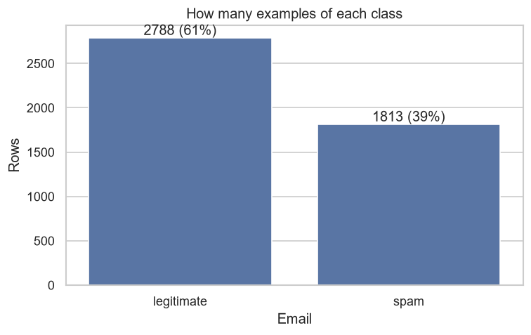
